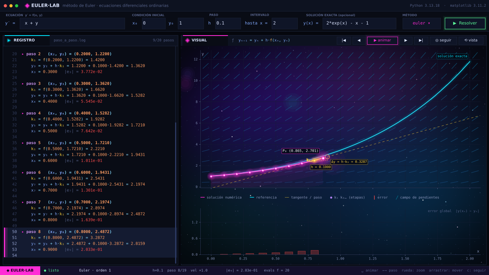

# Ecuaciones Diferenciales — Método de Euler

Proyecto de Ecuaciones Diferenciales sobre el **método de Euler**: una app en Python
que resuelve `y' = f(x, y)` **paso a paso** (registro de cada cálculo a la izquierda,
gráfica a la derecha) y un notebook con la historia, la explicación, por qué conviene
hacerlo en Python y qué puede fallar.



## Inicio rápido

Requiere Python 3.10+.

```bash
git clone https://github.com/317311022-crypto/Ecuaciones-Diferenciales-Metodo-Euler.git
cd Ecuaciones-Diferenciales-Metodo-Euler
python -m venv .venv
source .venv/bin/activate        # En Windows: .venv\Scripts\activate
pip install -r requirements.txt
python euler_app.py
```

La ecuación y los parámetros se escriben **al inicio de `euler_app.py`**:

```python
ECUACION = "x + y"              # y' = f(x, y)
X0 = 0                          # condición inicial: y(X0) = Y0
Y0 = 1
H = 0.1                         # tamaño de paso
X_FINAL = 2                     # integrar hasta aquí
METODO = "euler"                # "euler", "heun", "rk4" o cualquier método registrado
EXACTA = "2*exp(x) - x - 1"     # opcional: solución exacta para medir el error
```

…y también se pueden cambiar dentro de la ventana (barra superior, `Enter` o **▶ Resolver**).
Otra forma de abrirla: `python -m edo.app "y(1 - y/10)" --y0 1 --h 0.5 --hasta 10 --metodo rk4`.

> En Linux, si aparece un error de Tk: `sudo apt install python3-tk`. En Jupyter/Spyder usa
> un backend interactivo (`%matplotlib qt`) o ejecuta el archivo desde una terminal.

## La app: Euler·Lab

| Zona | Qué muestra |
|---|---|
| **Arriba** | Ecuación `y' = f(x, y)`, condición inicial, `h`, intervalo, solución exacta (opcional), método. |
| **Izquierda — registro** | Cada paso: el punto `(xₙ, yₙ)`, cada evaluación `k₁ = f(…)`, la fórmula con los números sustituidos (`y₁ = y₀ + h·k₁ = 1.0000 + 0.1000·1.0000 = 1.1000`) y el error. Avisos ⚠ y errores ✖ en el mismo registro. |
| **Derecha — gráfica** | Campo de pendientes, solución de referencia, poligonal del método con luminiscencia, y del paso actual: recta tangente, triángulo `h` / `Δy`, etapas `k₁…k₄`, error. Abajo, el error global por nodo. Fondo con efecto **parallax**. |
| **Barra de estado** | Estado, método y orden, paso actual, error, evaluaciones de `f`, coordenadas del ratón. |

Tema oscuro de alto contraste tipo entorno de desarrollo; los colores de `k₁, k₂…` son
los mismos en el registro y en la gráfica.

**Controles:** `espacio` animar/pausar · `←` `→` paso a paso · `inicio`/`fin` · `c` cámara
que sigue al punto · rueda = zoom (gráfica) o desplazar (registro) · arrastrar = mover ·
doble clic o `r` = vista inicial · `+`/`-` velocidad · `m` siguiente método · clic en el
registro = ir a ese paso.

**La ecuación se escribe como en clase:** `x + y`, `y' = 2xy`, `y(1 - y/10)`, `sen(x)·y`,
`e^(-x) - y`, `sqrt(abs(y))`. `^` es potencia, `2x` es `2*x`. El texto se analiza con `ast`
y solo se permiten números, `x`/`t`, `y`, operaciones y funciones matemáticas (nunca se
ejecuta código arbitrario).

**Detecta lo que puede fallar:** pasos inestables (`|R(h·∂f/∂y)| > 1`), soluciones que
explotan, asíntotas que el método cruza sin notarlo, `f` no definida y falta de unicidad
(`f` no Lipschitz).

## Notebook

[`notebooks/metodo_euler.ipynb`](notebooks/metodo_euler.ipynb) (ya ejecutado, se puede leer en GitHub):

1. **Historia**: de la poligonal de Euler (1768) y Cauchy a Runge–Kutta, la rigidez, Dahlquist y las Neural ODEs.
2. **Explicación**: tres deducciones, geometría, ejemplo a mano, error y orden, estabilidad, aplicación (enfriamiento).
3. **¿En qué ayuda que esté en Python?**: legibilidad, NumPy (miles de condiciones iniciales a la vez), comparación con SciPy, ecuaciones como texto seguro, ventajas y costos.
4. **¿Qué puede fallar?**: paso grande, inestabilidad, explosión en tiempo finito, no unicidad, `f` no definida, energía, redondeo, errores típicos al programar.
5. **La app** y cómo está construida (luminiscencia, parallax, blitting).
6. **Agregar otro método**: punto medio y Euler implícito.

```bash
pip install notebook
jupyter notebook notebooks/metodo_euler.ipynb
# o regenerarlo sin Jupyter:
python scripts/construir_notebook.py
```

## Agregar un método

Crea una clase que herede de `MetodoNumerico`, implementa `paso` y regístrala. Si evalúas
`f` con `self.evaluar(...)`, la app muestra cada evaluación en el registro y en la gráfica:

```python
import numpy as np
from edo import MetodoNumerico, registrar

@registrar
class PuntoMedio(MetodoNumerico):
    nombre = "punto_medio"
    nombre_completo = "Punto medio"
    orden = 2
    formula = "yₙ₊₁ = yₙ + h·k₂"

    def paso(self, f, t, y, h):
        k1 = self.evaluar(f, t, y, "k1")
        k2 = self.evaluar(f, t + h / 2, y + h / 2 * k1, "k2")
        return y + h * k2

    def funcion_estabilidad(self, z):        # opcional: avisos de inestabilidad
        return 1 + z + z**2 / 2
```

Para que quede permanente: guárdala en `edo/metodos/punto_medio.py` e impórtala en
`edo/metodos/__init__.py`. Aparece sola en el botón de método de la app, en
`resolver(..., metodo="punto_medio")` y en la línea de comandos. La app no tiene ningún
caso especial por método.

## Uso como biblioteca

```python
from edo import Configuracion, Simulacion, ProblemaValorInicial, resolver
import numpy as np

# Paso a paso, igual que la app
sim = Simulacion(Configuracion("x + y", x0=0, y0=1, h=0.1, x_final=1, metodo="euler",
                               exacta="2exp(x) - x - 1"))
for paso in sim.pasos[:3]:
    print(sim.metodo.formula_numerica(paso))
print(sim.resumen(), sim.avisos)

# Con funciones de Python (también sistemas: y0 vectorial)
pvi = ProblemaValorInicial(f=lambda t, y: y - t**2 + 1, t0=0, y0=0.5, t_final=2,
                           solucion_exacta=lambda t: (t + 1)**2 - 0.5 * np.exp(t))
print(resolver(pvi, "euler", h=0.2).tabla())
```

Línea de comandos (tablas y gráficas estáticas):

```bash
python -m edo --listar
python -m edo --problema burden --metodo euler --h 0.2
python -m edo --problema burden --convergencia
```

## Estructura

```
├── euler_app.py             # Lanzador: ecuación y parámetros al inicio del archivo
├── edo/
│   ├── expresion.py         # Texto → función segura (ast + lista blanca)
│   ├── problema.py          # ProblemaValorInicial
│   ├── metodos/             # Un archivo por método + registro por nombre
│   │   ├── base.py          #   MetodoNumerico, Paso, Etapa (traza de evaluaciones)
│   │   ├── euler.py         #   Método de Euler  ← plantilla para métodos nuevos
│   │   ├── heun.py, rk4.py  #   Para comparar
│   │   └── registro.py
│   ├── solucionador.py      # resolver(): ciclo común a todos los métodos
│   ├── simulacion.py        # Corrida paso a paso + referencia + avisos (modelo de la app)
│   ├── graficas.py          # Gráficas estáticas (notebook)
│   └── app/                 # Interfaz (solo dibuja)
│       ├── tema.py          #   Colores y fuentes
│       ├── efectos.py       #   Luminiscencia y parallax
│       ├── consola.py       #   Registro con resaltado de sintaxis
│       ├── grafica.py       #   Panel de la gráfica
│       └── ventana.py       #   Ventana, eventos y animación
├── notebooks/metodo_euler.ipynb
├── scripts/construir_notebook.py
└── tests/                   # pytest (incluye la app sin ventana)
```

Solo depende de **NumPy** y **matplotlib** (la app usa los widgets de matplotlib; no hace
falta ningún framework de interfaces).

## Pruebas

```bash
pip install pytest
pytest
```

Verifican la Tabla 5.1 de Burden & Faires, el orden de convergencia de cada método, el
analizador de expresiones (incluido que rechace código malicioso), los avisos de
inestabilidad/explosión/unicidad y la app completa simulando ratón y teclado.

## Referencias

- L. Euler, *Institutionum calculi integralis*, vol. 1 (1768).
- E. Hairer, S. P. Nørsett, G. Wanner, *Solving Ordinary Differential Equations I*, Springer.
- J. C. Butcher, "A history of Runge–Kutta methods", *Appl. Numer. Math.* 20 (1996).
- R. L. Burden, J. D. Faires, *Análisis Numérico*, cap. 5.
- D. G. Zill, *Ecuaciones Diferenciales con Aplicaciones de Modelado*, sec. 2.6.
